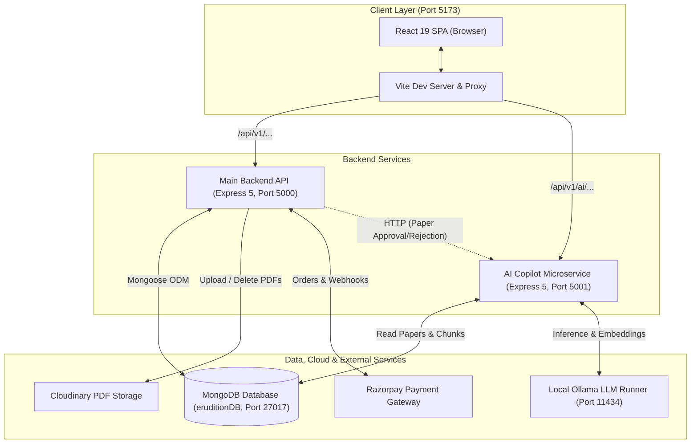
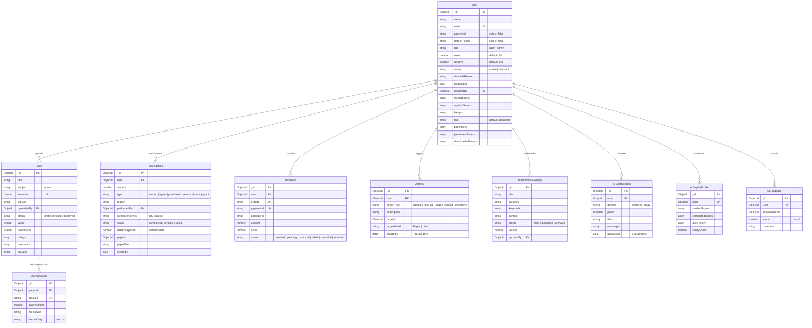
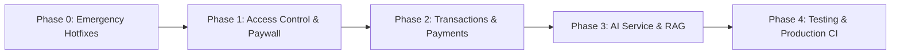

# StudyTogether — Master Project Plan & Architecture Reference

> **Document Version**: 1.1.0 (Stabilized & Verified)  
> **Repository**: `StudyTogether` (Git Branch: `backend-verification`)  
> **Last Updated**: 2026-10-24  
> **Source Documents Consolidated**:
> - [`README.md`](file:///C:/Users/SWARNENDU/Downloads/StudyTogether/README.md)
> - [`PROJECT_CONTEXT.md`](file:///C:/Users/SWARNENDU/Downloads/StudyTogether/PROJECT_CONTEXT.md)
> - [`AUDIT_REPORT.md`](file:///C:/Users/SWARNENDU/Downloads/StudyTogether/AUDIT_REPORT.md)
> - [`FIX_PLAN.md`](file:///C:/Users/SWARNENDU/Downloads/StudyTogether/FIX_PLAN.md)
> - [`STABILIZATION_AND_FEATURES.md`](file:///C:/Users/SWARNENDU/Downloads/StudyTogether/STABILIZATION_AND_FEATURES.md)
> - [`StudyTogether_Project_Audit_Handoff_EN.md`](file:///C:/Users/SWARNENDU/Downloads/StudyTogether/StudyTogether_Project_Audit_Handoff_EN.md)
> - [`CODE_OF_CONDUCT.md`](file:///C:/Users/SWARNENDU/Downloads/StudyTogether/CODE_OF_CONDUCT.md)
> - [`CONTRIBUTING.md`](file:///C:/Users/SWARNENDU/Downloads/StudyTogether/CONTRIBUTING.md)
> - `.github/pull_request_template.md` & `.github/ISSUE_TEMPLATE/*.md`

---

## 1. Project Purpose, Goals & User Roles

### 1.1 Project Purpose & Overview
**StudyTogether** is a full-stack, peer-to-peer academic resource-sharing platform tailored for college students. Students upload, discover, preview, download, rate, and discuss previous-year exam question papers, lecture notes, and study resources.

The platform incentivizes academic contribution through a gamified virtual economy (**"Study Coins"**):
- Uploading quality, admin-approved academic resources rewards contributors with coins.
- Students spend coins to preview or download peers' study materials.
- Gamification mechanics (daily login streaks, automated badge awards, and dynamic user rank progression) foster community engagement.
- An integrated **AI Study Copilot** provides document-grounded question answering (RAG), automated study notes, flashcards, quizzes, and personalized exam preparation plans.

*(Source: `README.md`, `PROJECT_CONTEXT.md`, `STABILIZATION_AND_FEATURES.md`)*

### 1.2 User Roles & Permissions Matrix

| Platform Capability | Unauthenticated Visitor | Student / Registered User | Platform Administrator |
| :--- | :---: | :---: | :---: |
| View Public Landing Page (`/`) | ✅ | ✅ | ✅ |
| View Public User Profiles (`/profile/:id`) | ⚠️ (API Public; UI Blocked by Route Guard) | ✅ | ✅ |
| View Public Activity Feed (`/api/v1/users/activity`) | ✅ | ✅ | ✅ |
| Register / Login / Password Reset | ✅ | ✅ | ✅ |
| Browse & Search Approved Papers (`/papers`) | ❌ (Blocked by Auth) | ✅ | ✅ |
| Preview Papers (10 Coins) | ❌ | ✅ (Free if Owner/Admin) | ✅ (Free) |
| Download Papers (40 Coins / 30 if previewed) | ❌ | ✅ (Free if Owner/Admin) | ✅ (Free) |
| Save Draft Papers (No limit) | ❌ | ✅ | ✅ |
| Submit Papers for Review | ❌ | ✅ (Max 2 Pending Uploads) | ✅ (Auto-approved) |
| Rate Papers (1–5 Stars) | ❌ | ✅ (1 Vote per paper; Non-admins only) | ❌ (View only) |
| Add / Delete Comments | ❌ | ✅ (Own comments) | ✅ (Any comment) |
| Toggle Bookmarks (`/bookmarks`) | ❌ | ✅ | ✅ |
| Buy Coin Packages (Razorpay) | ❌ | ✅ | ✅ |
| View Transaction Ledger (`/wallet`) | ❌ | ✅ | ✅ |
| AI Chat Copilot & Study Tools | ❌ | ✅ | ✅ |
| Access Moderation Queue (`/admin/pending`) | ❌ | ❌ | ✅ |
| Single & Bulk Paper Moderation | ❌ | ❌ | ✅ |
| Change User Roles / Delete Users | ❌ | ❌ | ✅ |
| Issue Manual Coin Refunds | ❌ | ❌ | ✅ |
| Platform Knowledge CRUD | ❌ | ❌ | ✅ |
| Rebuild AI Vector Index (`/reindex`) | ❌ | ❌ | ✅ |

*(Source: `README.md` §10, `PROJECT_CONTEXT.md` §3, verified against `server/routes/`)*

---

## 2. Technology Stack & System Architecture

### 2.1 Technology Stack

#### Frontend (`client/`)
- **Framework**: React 19.2.0, React DOM 19.2.0
- **Build Tool / Bundler**: Vite 7.3.1 (ES Modules, Hot Module Replacement)
- **Styling**: Tailwind CSS 3.4.19, PostCSS, Autoprefixer
- **Routing**: React Router DOM 7.13.0 (lazy-loaded routes with `Suspense` fallback)
- **State & Server Cache**: TanStack React Query 5.28.0 (infinite scroll caching, background invalidation)
- **HTTP Client**: Axios 1.13.5 (configured with `withCredentials: true`, request bearer injection, 401 refresh interceptors)
- **Document Viewing & Uploads**: `react-pdf` 10.4.1, `pdfjs-dist` 5.4.296 (in-browser PDF rendering with page navigation and zoom), `react-dropzone` 15.0.0 (drag-and-drop file upload interface)
- **UI Components & Lists**: `lucide-react` 1.24.0, `framer-motion` 12.42.2, `react-hot-toast` 2.6.0, `recharts` 3.8.0, `react-infinite-scroll-component` 6.1.0
- **Routing Note**: `App.jsx` defines inline `ProtectedRoute` and `AdminRoute` wrappers; standalone route files [`client/src/routes/ProtectedRoute.jsx`](file:///C:/Users/SWARNENDU/Downloads/StudyTogether/client/src/routes/ProtectedRoute.jsx) and [`client/src/routes/AdminRoute.jsx`](file:///C:/Users/SWARNENDU/Downloads/StudyTogether/client/src/routes/AdminRoute.jsx) are currently unused dead code.

#### Backend Server (`server/`)
- **Runtime**: Node.js v20+ / v24.18.0 (WSL2 Ubuntu)
- **Server Framework**: Express.js 5.2.1 (`"type": "module"`)
- **Database ODM**: Mongoose 9.2.0 (strict query mode, schema validation, compound indexes)
- **Security Middlewares**: `helmet` 8.1.0, `express-mongo-sanitize` 2.2.0, `express-rate-limit` 8.3.0, custom cookie parser
- **Authentication**: `jsonwebtoken` 9.0.3 (dual-token architecture: 15m access token + 7d HttpOnly refresh token), `bcryptjs` 3.0.3
- **File Handling**: `multer` 2.1.1, `multer-storage-cloudinary` 4.0.0, `cloudinary` 1.41.3
- **Payment Processing**: `razorpay` 2.9.6, Node crypto HMAC-SHA256 signature verification
- **Environment Management**: `dotenv` 17.2.4 via centralized loader [`server/config/env.js`](file:///C:/Users/SWARNENDU/Downloads/StudyTogether/server/config/env.js)

#### AI Microservice (`ai/`)
- **Runtime**: Node.js / Express.js 5.2.1 (Port 5001)
- **LLM Runner**: Local Ollama instance (`mistral` LLM, `nomic-embed-text` embeddings)
- **Document Text & OCR**: `pdf-parse` 1.1.1, `tesseract.js` 5.1.1, `pdf-img-convert` 2.0.0
- **Retrieval Engine**: Hybrid search combining Cosine Vector Similarity + BM25 keyword scoring
- **Streaming**: Server-Sent Events (SSE) token streaming via `/api/v1/ai/chat/stream`

#### Infrastructure & Database
- **Primary Database**: MongoDB (Local standalone / replica-set in WSL on port 27017 or MongoDB Atlas Cloud)
- **File Storage**: Cloudinary (Cloud-hosted raw PDF storage under `study-together/papers`)
- **Payment Gateway**: Razorpay (Web checkout, HMAC-SHA256 webhooks)

*(Source: `README.md` §3, `PROJECT_CONTEXT.md` §2, `package.json` files)*

### 2.2 System Architecture Diagram



*(Source: `PROJECT_CONTEXT.md` §2, `STABILIZATION_AND_FEATURES.md` §2, `StudyTogether_Project_Audit_Handoff_EN.md` §2)*

---

## 3. Existing Frontend Pages & Features

### 3.1 Route Catalog & Layout

| Path | Component | Guard | Description | Verified Status |
| :--- | :--- | :--- | :--- | :--- |
| `/` | [`Home.jsx`](file:///C:/Users/SWARNENDU/Downloads/StudyTogether/client/src/pages/Home.jsx) | Public | Marketing landing page with hero banner, CTAs, platform features, and trending papers preview. | Verified UI / Unauth fix verified |
| `/login` | [`Login.jsx`](file:///C:/Users/SWARNENDU/Downloads/StudyTogether/client/src/pages/Login.jsx) | Public | Email and password login, show/hide password toggle, error alert banner, loading spinner. | Verified UI & Form validation |
| `/register` | [`Register.jsx`](file:///C:/Users/SWARNENDU/Downloads/StudyTogether/client/src/pages/Register.jsx) | Public | Full signup with name, email, password, confirm password, terms checkbox, and dynamic password strength meter. | Verified UI & Form validation |
| `/dashboard` | [`Dashboard.jsx`](file:///C:/Users/SWARNENDU/Downloads/StudyTogether/client/src/pages/Dashboard.jsx) | Protected | User overview displaying upload metrics (total, approved, pending) and quick action shortcuts. | Code Verified / Requires Auth |
| `/profile` | [`Profile.jsx`](file:///C:/Users/SWARNENDU/Downloads/StudyTogether/client/src/pages/Profile.jsx) | Protected | User profile, name and password updates, earned badges, calculated rank, and personal papers list. | Code Verified / Requires Auth |
| `/profile/:id` | [`PublicProfile.jsx`](file:///C:/Users/SWARNENDU/Downloads/StudyTogether/client/src/pages/PublicProfile.jsx) | Protected | Public contributor view displaying peer rank, badges, and monthly upload activity histogram. | Code Verified / Requires Auth |
| `/papers` | [`Papers.jsx`](file:///C:/Users/SWARNENDU/Downloads/StudyTogether/client/src/pages/Papers.jsx) | Protected | Catalog with TanStack `useInfiniteQuery`, debounced search, subject and semester filter chips. | Code Verified / Requires Auth |
| `/papers/:id` | [`PaperDetails.jsx`](file:///C:/Users/SWARNENDU/Downloads/StudyTogether/client/src/pages/PaperDetails.jsx) | Protected | Paper detail view, inline PDF viewer modal (`react-pdf`), star ratings, comment thread, coin preview/download. | Code Verified / Requires Auth |
| `/my-papers` | [`MyPapers.jsx`](file:///C:/Users/SWARNENDU/Downloads/StudyTogether/client/src/pages/MyPapers.jsx) | Protected | Personal paper manager to view status (approved, pending, draft), edit metadata, or delete uploads. | Code Verified / Requires Auth |
| `/upload-paper`| [`UploadPaper.jsx`](file:///C:/Users/SWARNENDU/Downloads/StudyTogether/client/src/pages/UploadPaper.jsx) | Protected | Multi-step form with drag-and-drop PDF upload, subject whitelist selector, draft toggle, and 2-pending limit guard. | Code Verified / Requires Auth |
| `/bookmarks` | [`Bookmarks.jsx`](file:///C:/Users/SWARNENDU/Downloads/StudyTogether/client/src/pages/Bookmarks.jsx) | Protected | Saved study paper bookmarks with remove toggle. | Code Verified / Requires Auth |
| `/leaderboard`| [`Leaderboard.jsx`](file:///C:/Users/SWARNENDU/Downloads/StudyTogether/client/src/pages/Leaderboard.jsx) | Protected | Top 10 contributor rankings, gold/silver/bronze badges (🥇, 🥈, 🥉), coin balances, and rank pills. | Code Verified / Requires Auth |
| `/wallet` | [`Wallet.jsx`](file:///C:/Users/SWARNENDU/Downloads/StudyTogether/client/src/pages/Wallet.jsx) | Protected | Virtual wallet displaying coin balance, package purchase cards, Razorpay checkout modal, and payment history. | Code Verified / Requires Auth |
| `/admin` | [`Admin.jsx`](file:///C:/Users/SWARNENDU/Downloads/StudyTogether/client/src/pages/Admin.jsx) | Admin | Comprehensive control panel: platform stats, user management table, role toggling, Recharts analytics, refund modal. | Code Verified / Requires Admin |
| `/admin/pending`| [`AdminPending.jsx`](file:///C:/Users/SWARNENDU/Downloads/StudyTogether/client/src/pages/AdminPending.jsx) | Admin | Moderation queue for pending uploads with inline PDF preview, approve (`+30` coins), and reject actions. | Code Verified / Requires Admin |
| `/assistant` | [`AIAssistant.jsx`](file:///C:/Users/SWARNENDU/Downloads/StudyTogether/client/src/pages/AIAssistant.jsx) | Protected | Full-page AI study conversation interface, token streaming, study notes generator, quiz generator, flashcards. | Code Verified / Requires Auth & AI Service |

### 3.2 Floating & Shared Components
- **Navbar (`client/src/components/common/Navbar.jsx`)**: Responsive navigation bar, dark mode theme toggle, coin balance badge, notification links, and user dropdown menu.
- **ChatWidget (`client/src/components/ai/ChatWidget.jsx`)**: Floating circular trigger button anchored at the bottom-right; automatically hidden for unauthenticated users and on `/assistant`.
- **ErrorBoundary (`client/src/components/common/ErrorBoundary.jsx`)**: React class error boundary wrapping the router to capture and display fallback recovery UI upon unexpected component runtime exceptions.
- **PDFViewer & PDFModal (`client/src/components/papers/`)**: Canvas-rendered PDF viewer using `pdfjs-dist` with page navigation controls, zoom modifiers, and fullscreen presentation.

*(Source: `PROJECT_CONTEXT.md` §3, verified against `client/src/`)*

---

## 4. Backend API Routes, Controllers & Middleware

All routes on the main backend service are prefixed under `/api/v1`.

### 4.1 Authentication Router (`/api/v1/auth`)
- `POST /api/v1/auth/register`: Public. Validates `name` ($\ge$ 3 chars), `email` (regex), `password` ($\ge$ 8 chars). Hashes password with bcryptjs (cost 10). Grants 50 default coins. Returns 201 with sanitized user.
- `POST /api/v1/auth/login`: Public. Validates credentials. Returns 15m `accessToken` in JSON body and sets 7d `refreshToken` HttpOnly strict cookie. Rate limited (10 attempts / 15 min).
- `POST /api/v1/auth/refresh`: Public. Reads refresh token from cookie or body. Validates `tokenType === "refresh"` and matches raw stored token string in `user.refreshToken`. Issues new 15m access token.
- `POST /api/v1/auth/logout`: Protected (`verifyToken`). Clears user's `refreshToken` in DB and clears client cookie.

### 4.2 Study Papers Router (`/api/v1/papers`)
- `GET /api/v1/papers`: Protected (`verifyToken`). Query: `page`, `limit`, `search`, `subject`, `semester`, `sort`. Full-text regex search over approved papers.
- `POST /api/v1/papers/upload`: Protected (`verifyToken`, `sensitiveActionLimiter`). Multer parses single PDF ($\le$ 5MB). Verifies subject against whitelist. Enforces max 2 pending uploads for regular users. Uploads to Cloudinary (`study-together/papers`).
- `GET /api/v1/papers/trending`: Protected (`verifyToken`). Computes top 5 papers sorted by popularity (`views + downloads * 2 + averageRating * 10`).
- `GET /api/v1/papers/:id`: Protected (`verifyToken`). Fetches paper details and populates author. Only allows viewing unapproved papers if requester is author or admin.
- `GET /api/v1/papers/:id/related`: Protected (`verifyToken`). Fetches up to 3 approved papers sharing identical subject or semester.
- `PUT /api/v1/papers/:id`: Protected (`verifyToken`). Author or admin can update metadata or replace PDF file.
- `DELETE /api/v1/papers/:id`: Protected (`verifyToken`). Author or admin can delete paper; destroys Cloudinary asset and deletes DB record.
- `POST /api/v1/papers/:id/view`: Protected (`verifyToken`). Increments view count; charges 10 coins if user is not author/admin and hasn't previewed before; returns `pdfLink`.
- `POST /api/v1/papers/:id/download`: Protected (`verifyToken`). Increments download count; charges 40 coins (or 30 if previewed); returns `pdfLink`.
- `POST /api/v1/papers/:id/rate`: Protected (`verifyToken`). 1–5 star rating submission. Non-admins only; enforces one vote per user.
- `POST /api/v1/papers/:id/comment`: Protected (`verifyToken`). Appends comment (2–500 characters) to paper.
- `DELETE /api/v1/papers/:paperId/comment/:commentId`: Protected (`verifyToken`). Comment author or admin can remove comment.
- `GET /api/v1/papers/admin/pending`: Admin only (`verifyToken`, `verifyAdmin`). Lists all papers with status `"pending"`.
- `PUT /api/v1/papers/admin/approve/:id`: Admin only. Updates status to `"approved"`, awards `+30` coins to uploader, logs activity, and calls AI service to ingest PDF.
- `DELETE /api/v1/papers/admin/reject/:id`: Admin only. Destroys Cloudinary asset, deletes DB record, and calls AI service to purge knowledge chunks.
- `POST /api/v1/papers/admin/bulk-approve` & `POST /api/v1/papers/admin/bulk-reject`: Admin only. Batch moderation over paper ID arrays.
- `GET /api/v1/papers/top-papers`: Admin only (`verifyToken`, `verifyAdmin`). Fetches top 5 approved papers sorted by downloads and views.

### 4.3 Users & Gamification Router (`/api/v1/users`)
- `GET /api/v1/users/profile`: Protected (`verifyToken`). Current session details, bookmarks list, and calculated tier rank.
- `PUT /api/v1/users/update`: Protected (`verifyToken`). Updates user name and/or password (invalidates session on password update).
- `DELETE /api/v1/users/delete`: Protected (`verifyToken`). Account self-deletion cascading to user's uploaded papers and Cloudinary assets. Prevents last admin from deleting themselves.
- `GET /api/v1/users/stats`: Protected (`verifyToken`). User's approved, pending, and total upload counts.
- `GET /api/v1/users/my-papers`: Protected (`verifyToken`). List of papers uploaded by authenticated user.
- `POST /api/v1/users/bookmark/:id`: Protected (`verifyToken`). Toggles paper ID inside user's bookmarks array.
- `GET /api/v1/users/coin-overview`: Protected (`verifyToken`). Paginated ledger of earned, spent, purchased, and refunded transactions.
- `GET /api/v1/users/leaderboard`: Protected (`verifyToken`). Top 10 users ranked by coin total and approved upload counts.
- `GET /api/v1/users/activity`: Public. Global activity stream (uploads, badge milestones, rank promotions).
- `GET /api/v1/users/public/:id`: Public. Public profile metadata for contributor attribution.
- `GET /api/v1/users/public/:id/stats`: Public. Monthly upload histogram aggregate for contributor chart.

### 4.4 Payments & Economy Router (`/api/v1/payment` & `/api/v1/coins`)
- `GET /api/v1/coins/packages`: Public. Returns package metadata (Starter: ₹29/100 coins, Popular: ₹59/250 coins, Premium: ₹99/500 coins).
- `POST /api/v1/payment/create-order`: Protected (`verifyToken`). Creates a Razorpay order via Razorpay SDK and stores `Payment` document in `"created"` status.
- `POST /api/v1/payment/verify`: Protected (`verifyToken`). Verifies HMAC-SHA256 signature against `RAZORPAY_KEY_SECRET`.
- `POST /api/v1/payment/webhook`: Public Webhook. Parses raw JSON body, verifies `x-razorpay-signature` against `RAZORPAY_WEBHOOK_SECRET`, transitions payment to `"captured"`, and credits coins to user atomically.
- `GET /api/v1/payment/history`: Protected (`verifyToken`). Payment history for the logged-in user.
- `GET /api/v1/payment/admin/analytics`: Admin only. Total revenue, payment counts, and coins sold.
- `GET /api/v1/payment/admin/package-sales`: Admin only. Sales volume breakdown by package name.
- `GET /api/v1/payment/admin/list`: Admin only. Paginated, searchable payment audit ledger.
- *`POST /api/v1/coins/purchase`*: Protected (`verifyToken`). **Known Mock Route** (instantly credits coins without charging; see Vulnerabilities §11).

### 4.5 Admin Control Center (`/api/v1/admin`)
- `GET /api/v1/admin/users`: Admin only. Paginated, searchable user directory.
- `DELETE /api/v1/admin/users/:id`: Admin only. Deletes user account and cleans up assets. Prevents self-deletion.
- `PUT /api/v1/admin/users/:id/role`: Admin only. Changes user role (`"user"` $\leftrightarrow$ `"admin"`). Prevents self role demotion.
- `PUT /api/v1/admin/users/:id/status` & `PATCH`: Admin only. Disables or re-enables user or admin accounts. Requires non-empty `reason`. Prevents self-disable. Revokes refresh tokens immediately and denies real-time access across all protected routes.
- `POST /api/v1/admin/users/:id/grant-coins`: Admin only. Grants custom positive integer coin amount (1–10,000) to selected active accounts. Requires non-empty `reason` and `idempotencyKey`. Protected by sparse unique index, single-document atomic update on `User.appliedGrants`, and crash-recoverable state machine.
- `GET /api/v1/admin/stats`: Admin only. System aggregates (users, admins, views, downloads, comments, ratings).
- `GET /api/v1/admin/top-contributors`: Admin only. Top 10 uploaders by approved papers.
- `GET /api/v1/admin/top-coin-holders`: Admin only. Top 10 users by current coin balance.
- `GET /api/v1/admin/coin-analytics`: Admin only. Aggregate metrics of total currency in circulation.
- `POST /api/v1/admin/users/:id/refund`: Admin only. Atomically credits coins back to a student and records audit transaction.
- `GET / POST / PUT / DELETE /api/v1/admin/platform-knowledge*`: Admin only. CRUD management of platform knowledge base articles (`/`, `/:id`, `/:id/status`, `/:id/publish`, `/:id/archive`).

### 4.6 AI Copilot Microservice Endpoints (Port 5001)

#### Internal Pipelines (Unauthenticated in current code — see Finding SEC-003):
- `POST /api/v1/internal/ai/process`: Ingests and embeds a newly approved paper.
- `POST /api/v1/internal/ai/reprocess`: Re-extracts and re-indexes an updated paper.
- `DELETE /api/v1/internal/ai/knowledge/:paperId`: Purges all vector chunks associated with a rejected/deleted paper.

#### External AI Routes (`/api/v1/ai`):
- `POST /api/v1/ai/conversation` & `/conversations`: Protected (`verifyToken`). Initializes new chat session (`AIChatSession`).
- `POST /api/v1/ai/chat`: Protected (`verifyToken`). Dispatches conversational prompt and returns full response.
- `POST /api/v1/ai/chat/stream`: Protected (`verifyToken`). Token-by-token Server-Sent Events (SSE) streaming chat.
- `GET /api/v1/ai/history`: Protected (`verifyToken`). Paginated list of past user conversation sessions.
- `GET /api/v1/ai/conversations/:id`: Protected (`verifyToken`). Loads specific conversation session and message history.
- `DELETE /api/v1/ai/history/:id`: Protected (`verifyToken`). Deletes specific conversation session.
- `DELETE /api/v1/ai/conversations`: Protected (`verifyToken`). Clears all conversation sessions for user.
- `POST /api/v1/ai/reindex`: Admin only (`verifyToken`, `verifyAdmin`). Re-indexes all approved papers in bulk.
- `POST /api/v1/ai/study-notes`: Protected (`verifyToken`). Generates topic study summary from paper text.
- `POST /api/v1/ai/quiz`: Protected (`verifyToken`). Synthesizes multiple-choice questions from paper context.
- `POST /api/v1/ai/flashcards`: Protected (`verifyToken`). Produces question-answer flashcard deck.
- `POST /api/v1/ai/exam-plan`: Protected (`verifyToken`). Generates structured revision and study schedule.
- `POST /api/v1/ai/topic-analysis`: Protected (`verifyToken`). Breaks down topic frequency and conceptual weight.
- `GET /api/v1/ai/copilot/profile`: Protected (`verifyToken`). Retrieves user study streak, completed topics, and quiz history.
- `POST /api/v1/ai/copilot/track-progress`: Protected (`verifyToken`). Increments study metrics and marks topics completed.
- `POST /api/v1/ai/copilot/quiz-score`: Protected (`verifyToken`). Logs quiz attempt score into `AICopilotProfile`.
- `GET /api/v1/ai/copilot/recommendations`: Protected (`verifyToken`). Recommends papers based on study history.
- `GET /api/v1/ai/copilot/dashboard`: Protected (`verifyToken`). Aggregates study stats, streak count, and quiz metrics.
- `POST /api/v1/ai/feedback`: Protected (`verifyToken`). Stores user thumbs up/down rating and comments in `AIFeedback`.
- `GET /api/v1/ai/study-knowledge`: Protected (`verifyToken`). Lists raw text knowledge chunks (`AIChatChunk`).
- `GET /api/v1/ai/study-knowledge/search`: Protected (`verifyToken`). Keyword regex search across indexed chunks.
- `GET /api/v1/ai/study-knowledge/:id`: Protected (`verifyToken`). Retrieves single chunk metadata.
- `GET /api/v1/ai/status`: Public. Health & operational status of Ollama runner and configured models.
- `GET /api/v1/ai/models`: Protected (`verifyToken`). Lists available local LLM and embedding models.
- `POST /api/v1/ai/models/switch`: Admin only (`verifyToken`, `verifyAdmin`). Dynamically changes active Ollama LLM model.

### 4.7 System Health
- `GET /api/v1/health` (Main API, Port 5000): Public. Returns `{ success: true, status: "healthy", services: { database: "connected" } }`.
- `GET /health` (AI Service, Port 5001): Public. Returns `{ status: "ok", service: "ai-module" }`.

*(Source: `README.md` §13, `PROJECT_CONTEXT.md` §4, verified in Backend Verification Phase)*

---

## 5. Database Models & Collections

All models are defined using Mongoose schemas and connect to the database specified by `MONGODB_URI`.



### Discrepancies Resolved Between Documents & Codebase:
1. **Activity Schema Field**: `README.md` documented the field as `details`, whereas `PROJECT_CONTEXT.md` and the actual codebase (`server/models/Activity.js` line 14) define it as `description`. The code is verified authoritative.
2. **Uploader Approval Reward**: `STABILIZATION_AND_FEATURES.md` stated authors receive 20 coins upon approval; `README.md` and the actual implementation in `server/routes/paper.js` line 301 award `+30` coins. The code is verified authoritative.
3. **User Rank Progression Hierarchy**: `STABILIZATION_AND_FEATURES.md` claimed rank tiers were `Newbie -> Bronze -> Silver -> Gold -> Diamond`, and earlier summary notes claimed `User.js` hardcoded `Guru / Master` thresholds. In the verified implementation, `server/models/User.js` defaults `rank: "Beginner"`, and [`server/services/rankService.js`](file:///C:/Users/SWARNENDU/Downloads/StudyTogether/server/services/rankService.js) authoritative logic calculates:
   - `Beginner`: Default rank.
   - `Explorer`: $\ge$ 50 coins & $\ge$ 1 approved upload.
   - `Scholar`: $\ge$ 100 coins & $\ge$ 5 approved uploads.
   - `Expert`: $\ge$ 250 coins & $\ge$ 10 approved uploads.
   - `Legend`: $\ge$ 500 coins & $\ge$ 20 approved uploads.
4. **Omitted Models & Fields in Documentation**:
   - `PlatformKnowledge` (`server/models/PlatformKnowledge.js` & `ai/models/PlatformKnowledge.js`) was omitted from initial documentation.
   - Microservice models `AIChatSession`, `AICopilotProfile`, and `AIFeedback` reside in `ai/models/`.
   - `AIChatChunk.js` defines `chunkText: { type: String, required: true }`, not `text`.
   - `Paper.js` enforces a unique compound index preventing duplicate uploads: `{ title: 1, subject: 1, semester: 1 }, { unique: true }`.

*(Source: `README.md` §12, `PROJECT_CONTEXT.md` §5, `server/models/`)*

---

## 6. AI Service Architecture & Current Status

### 6.1 Architectural Design
The AI Copilot operates as an independent microservice (`ai/`) running on **port 5001**:
- **PDF Extraction**: Reads text using `pdf-parse`. If text density is below threshold (scanned PDFs), it invokes OCR via `tesseract.js` paired with `pdf-img-convert`.
- **Chunking Pipeline**: Splits extracted text into fixed word chunks (120 words with 20-word overlap).
- **Embedding Generation**: Dispatches chunk batches to local Ollama (`nomic-embed-text`) generating 768-dimensional dense vectors stored in `AIChatChunk`.
- **Hybrid Retrieval Engine**:
  - Semantic vector score calculated via Cosine Similarity (`weight: 0.6`).
  - Lexical keyword score calculated via BM25 (`weight: 0.4`).
  - Merged and ranked to pull the top $k$ relevant context chunks.
- **Inference & Streaming**: Prompts the local `mistral` model running on Ollama (`http://localhost:11434`), streaming Server-Sent Events (SSE) tokens to `/api/v1/ai/chat/stream`.

### 6.2 Current Operational Status
- **Service Process**: Currently **stopped / offline** per explicit test instructions.
- **Frontend Fallback**: The client assistant page [`client/src/pages/AIAssistant.jsx`](file:///C:/Users/SWARNENDU/Downloads/StudyTogether/client/src/pages/AIAssistant.jsx#L21-L39) checks `/ai/status` on load. When offline, it gracefully disables the input field and displays an informative banner: `"AI Copilot is currently offline"`.
- **Floating Widget Guard**: [`client/src/components/ai/ChatWidget.jsx`](file:///C:/Users/SWARNENDU/Downloads/StudyTogether/client/src/components/ai/ChatWidget.jsx#L8) checks `localStorage.getItem("accessToken")` and remains hidden if the user is unauthenticated or already on the `/assistant` page.

*(Source: `README.md` §2, `PROJECT_CONTEXT.md` §4.2 & §6, `AUDIT_REPORT.md` §5)*

---

## 7. External Integrations

### 7.1 Cloudinary (PDF Storage)
- **Configuration**: Initialized via [`server/config/cloudinary.js`](file:///C:/Users/SWARNENDU/Downloads/StudyTogether/server/config/cloudinary.js).
- **Upload Mechanism**: Uses `multer-storage-cloudinary` in `server/middleware/uploadCloudinary.js`. Files are stored as raw PDF assets with a generated UUID under folder `study-together/papers`.
- **Deletion Mechanism**: When papers are rejected or deleted, `cloudinary.uploader.destroy(publicId, { resource_type: "raw" })` purges the asset.
- **Security Finding (Partially Fixed)**: Removed previous debug logs in `server/config/cloudinary.js` that printed `API_KEY` and `API_SECRET`. However, **an active leak remains in [`ai/config/cloudinary.js#L6-L9`](file:///C:/Users/SWARNENDU/Downloads/StudyTogether/ai/config/cloudinary.js#L6-L9)** which still prints `API_SECRET` to standard output (slated for cleanup in Phase 0).

### 7.2 Razorpay (Payment Gateway)
- **Configuration**: Initialized via [`server/config/razorpay.js`](file:///C:/Users/SWARNENDU/Downloads/StudyTogether/server/config/razorpay.js).
- **Checkout Flow**: Frontend requests order creation (`POST /api/v1/payment/create-order`). Backend invokes `razorpay.orders.create({ amount, currency: "INR" })` and returns order details.
- **Client Modal**: The frontend launches `new window.Razorpay(options).open()`.
- **Fulfillment & Verification**: Handled via cryptographically signed webhooks (`POST /api/v1/payment/webhook`). Validates `x-razorpay-signature` against `RAZORPAY_WEBHOOK_SECRET` before crediting coins.

### 7.3 Ollama (Local LLM Provider)
- **Configuration**: Connects to `OLLAMA_URL` (default `http://localhost:11434` or `http://127.0.0.1:11434`).
- **Models**: `nomic-embed-text` (embeddings) and `mistral` (generation).

*(Source: `README.md` §7, `PROJECT_CONTEXT.md` §7, `AUDIT_REPORT.md` §3)*

---

## 8. Local Development Setup & Health Checks

### 8.1 Prerequisites
- **Operating System**: Linux / WSL2 Ubuntu recommended.
- **Node.js**: v20.x or v24.x (verified on v24.18.0 with npm 11.16.0).
- **MongoDB**: Standalone or replica set running locally on port 27017.
- **Cloudinary Account**: Valid cloud name, API key, and API secret.
- **Ollama (Optional)**: Installed and running on port 11434 if testing AI features.

### 8.2 Installation & Startup Commands

```bash
# 1. Clone repository
git clone https://github.com/SwarnenduMani22/FINAL_YEAR.git StudyTogether
cd StudyTogether

# 2. Configure root .env (see Section 9 for required keys)

# 3. Install dependencies
npm install                 # Root dependencies
cd server && npm install    # Backend dependencies
cd ../client && npm install # Frontend dependencies
cd ../ai && npm install     # AI microservice dependencies (optional)
cd ..

# 4. Start backend server (from project root)
npm run server              # Starts Express on http://localhost:5000

# 5. Start frontend client (in separate terminal)
npm run client              # Starts Vite dev server on http://localhost:5173

# 6. Start AI service (optional, in separate terminal)
npm run dev --prefix ai     # Starts AI microservice on http://localhost:5001
```

### 8.3 Health Checks & Sanity Tests

```bash
# Check Main Server Health
curl -s http://localhost:5000/api/v1/health
# Expected: {"success":true,"status":"healthy","version":"1.0","services":{"database":"connected"}}

# Check Main Server via Frontend Vite Proxy
curl -s http://localhost:5173/api/v1/health
# Expected: Same 200 OK JSON response

# Check Public Coin Packages
curl -s http://localhost:5000/api/v1/coins/packages
# Expected: {"success":true,"packages":[{"id":"starter",...},{"id":"popular",...},{"id":"premium",...}]}

# Check AI Service Health (when running)
curl -s http://localhost:5001/health
# Expected: {"status":"ok","service":"ai-module"}
```

*(Source: `README.md` §6-8, `CONTRIBUTING.md` §4-6, verified during verification phases)*

---

## 9. Required Environment Variable Names

> [!IMPORTANT]
> In accordance with strict security standards, **only variable names are documented below**. Never commit real credential values or secrets to git.

### Root / Backend Environment Variables (`.env`)
- `PORT`: HTTP port for main backend (default `5000`).
- `NODE_ENV`: Runtime mode (`development` or `production`).
- `MONGODB_URI`: MongoDB connection URI (e.g. `mongodb://127.0.0.1:27017/eruditionDB`).
- `CLIENT_URL`: Client application URL for CORS (default `http://localhost:5173`).
- `JWT_SECRET`: Secret key used to sign short-lived access tokens (15m).
- `JWT_REFRESH_SECRET`: Separate secret key used to sign 7-day refresh tokens.
- `CLOUD_NAME`: Cloudinary cloud account name.
- `API_KEY`: Cloudinary public API key.
- `API_SECRET`: Cloudinary private API secret.
- `RAZORPAY_KEY_ID`: Razorpay merchant public key ID.
- `RAZORPAY_KEY_SECRET`: Razorpay merchant private secret.
- `RAZORPAY_WEBHOOK_SECRET`: Secret used to verify Razorpay webhook HMAC signatures.
- `AI_SERVICE_URL`: URL of the AI microservice (default `http://localhost:5001`).

### Frontend Environment Variables (`client/.env`)
- `VITE_API_URL`: Backend API base URL (default `http://localhost:5000/api/v1`).
- `VITE_API_BASE`: Optional alternate base URL referenced in [`client/src/utils/resolvePdfUrl.js`](file:///C:/Users/SWARNENDU/Downloads/StudyTogether/client/src/utils/resolvePdfUrl.js).
- `VITE_AI_API_URL`: AI microservice base URL (default `http://localhost:5001/api/v1`).

### AI Microservice Environment Variables (`ai/.env` or root `.env`)
- `AI_PORT`: Port for the AI microservice (default `5001`).
- `MONGODB_URI`: Shared MongoDB connection URI.
- `JWT_SECRET`: Shared secret used to verify user tokens for authenticated AI calls.
- `CORS_ORIGIN`: Allowed client origin for AI service CORS (default `http://localhost:5173`).
- `AI_PROVIDER`: Provider identifier (default `ollama`, or `disabled`).
- `LLM_PROVIDER`: Secondary provider switch (default `ollama`).
- `GEMINI_API_KEY`: API key for Gemini LLM fallback (referenced in `ai/services/index.js`).
- `OLLAMA_BASE_URL` / `OLLAMA_URL` / `OLLAMA_HOST`: Local Ollama instance URL (default `http://127.0.0.1:11434`).
- `OLLAMA_MODEL`: LLM model name (default `mistral`).
- `OLLAMA_EMBEDDING_MODEL` / `EMBEDDING_MODEL`: Embedding model name (default `nomic-embed-text`).
- `MAX_SESSION_MESSAGES`: Maximum message history retained per session (default `50`).
- `SESSION_TTL_SECONDS`: Chat session document retention in seconds (default `2592000` / 30 days).
- `PDF_CHUNK_SIZE_WORDS`: Ingestion chunk word size (default `120`).
- `PDF_CHUNK_OVERLAP_WORDS`: Ingestion chunk overlap word size (default `20`).
- `SEMANTIC_WEIGHT`: Hybrid search cosine similarity weight (default `0.6`).
- `BM25_WEIGHT`: Hybrid search lexical BM25 weight (default `0.4`).
- `CLOUD_NAME`, `API_KEY`, `API_SECRET`: Required for raw PDF asset fetches in `ai/config/cloudinary.js`.

> [!WARNING]
> **Outdated Documentation Note**: `.env.example` line 6 and `CONTRIBUTING.md` line 94 instruct users to copy environment variables to `server/.env`. However, the centralized loader [`server/config/env.js`](file:///C:/Users/SWARNENDU/Downloads/StudyTogether/server/config/env.js) explicitly loads the **root** `.env` (`path.resolve(__dirname, "../../.env")`). Placing environment variables exclusively in `server/.env` will result in startup failure!

*(Source: `README.md` §7, `PROJECT_CONTEXT.md` §8, root `.env` audit)*

---

## 10. Existing Features & Verification Status

| Subsystem | Feature | Target File | Verification Method | Status |
| :--- | :--- | :--- | :--- | :---: |
| **Backend** | Root `.env` Path Resolution | [`server/config/env.js`](file:///C:/Users/SWARNENDU/Downloads/StudyTogether/server/config/env.js) | Directory-independent path resolution via `import.meta.url` | **VERIFIED (PASS)** |
| **Backend** | Razorpay Initialization Safe Load | [`server/config/razorpay.js`](file:///C:/Users/SWARNENDU/Downloads/StudyTogether/server/config/razorpay.js) | Evaluates `env.js` before `new Razorpay(...)` | **VERIFIED (PASS)** |
| **Backend** | Cloudinary Credential Protection | [`server/config/cloudinary.js`](file:///C:/Users/SWARNENDU/Downloads/StudyTogether/server/config/cloudinary.js) | Removed plaintext `console.log` of `API_SECRET` | **VERIFIED (PASS)** |
| **Backend** | Health Check Endpoint | [`server/server.js`](file:///C:/Users/SWARNENDU/Downloads/StudyTogether/server/server.js) | `GET /api/v1/health` returns 200 OK + DB status | **VERIFIED (PASS)** |
| **Backend** | Public Coin Packages | [`server/routes/coin.js`](file:///C:/Users/SWARNENDU/Downloads/StudyTogether/server/routes/coin.js) | `GET /api/v1/coins/packages` returns 3 valid packages | **VERIFIED (PASS)** |
| **Backend** | Public Activity Feed | [`server/routes/user.js`](file:///C:/Users/SWARNENDU/Downloads/StudyTogether/server/routes/user.js) | `GET /api/v1/users/activity` returns empty list | **VERIFIED (PASS)** |
| **Backend** | Public Contributor Profile & Stats | [`server/routes/user.js`](file:///C:/Users/SWARNENDU/Downloads/StudyTogether/server/routes/user.js) | `GET /api/v1/users/public/:id` returns safe profile | **VERIFIED (PASS)** |
| **Backend** | Login Input Validation | [`server/routes/auth.js`](file:///C:/Users/SWARNENDU/Downloads/StudyTogether/server/routes/auth.js) | Returns 400 Bad Request on missing/invalid fields | **VERIFIED (PASS)** |
| **Backend** | Signup Field Validation | [`server/routes/auth.js`](file:///C:/Users/SWARNENDU/Downloads/StudyTogether/server/routes/auth.js) | Returns 400 on short name, short pw, bad email, existing user | **VERIFIED (PASS)** |
| **Backend** | Auth Rate Limiting | [`server/server.js`](file:///C:/Users/SWARNENDU/Downloads/StudyTogether/server/server.js) | Triggers 429 Too Many Requests after 10 failed attempts | **VERIFIED (PASS)** |
| **Backend** | Protected Route Auth Gate | `authMiddleware.js` | Rejects missing/malformed bearer tokens with 401 | **VERIFIED (PASS)** |
| **Frontend** | Client Bundle Compilation | Vite 7.3.1 | `vite build` completed in 40.5s; zero JSX or chunk errors | **VERIFIED (PASS)** |
| **Frontend** | Vite API Reverse Proxy | [`client/vite.config.js`](file:///C:/Users/SWARNENDU/Downloads/StudyTogether/client/vite.config.js) | Proxies `/api/*` to `:5000`; health check verified | **VERIFIED (PASS)** |
| **Frontend** | Unauthenticated Homepage Access | [`TrendingPapers.jsx`](file:///C:/Users/SWARNENDU/Downloads/StudyTogether/client/src/components/papers/TrendingPapers.jsx) | Unauthenticated visits remain on `/`; no forced redirect | **VERIFIED (PASS)** |
| **Frontend** | Trending Section Graceful Fallback| [`TrendingPapers.jsx`](file:///C:/Users/SWARNENDU/Downloads/StudyTogether/client/src/components/papers/TrendingPapers.jsx) | Displays `"No trending papers available"` without error | **VERIFIED (PASS)** |
| **Frontend** | Protected Route Navigation Guard | [`client/src/App.jsx`](file:///C:/Users/SWARNENDU/Downloads/StudyTogether/client/src/App.jsx) | Redirects unauthenticated visits on `/dashboard` to `/login` | **VERIFIED (PASS)** |
| **Frontend** | AI Assistant Offline Guard | [`AIAssistant.jsx`](file:///C:/Users/SWARNENDU/Downloads/StudyTogether/client/src/pages/AIAssistant.jsx) | Shows offline banner gracefully when AI service stopped | **VERIFIED (PASS)** |
| **Frontend** | Floating Chat Widget Guard | [`ChatWidget.jsx`](file:///C:/Users/SWARNENDU/Downloads/StudyTogether/client/src/components/ai/ChatWidget.jsx) | Automatically unmounts when unauthenticated | **VERIFIED (PASS)** |
| **Backend** | Account Status Enforcement | `admin.js`, `auth.js`, `authMiddleware.js` | Disables accounts with reason; blocks login (403), refresh (403), and active JWTs (403); rejects self-disable (400) | **VERIFIED (PASS)** |
| **Backend** | Manual Coin Grants & State Machine | `coinManager.js`, `admin.js` | Enforces 10k cap, sparse unique index on idempotencyKey, single-document atomicity on `User.appliedGrants`, zero double-credit on retry | **VERIFIED (PASS)** |
| **Frontend** | Admin Account Status Management | `AccountStatusModal.jsx`, `Admin.jsx` | Enable/disable modal with self-disable block, mandatory reason, explicit confirmation, status badge in table | **VERIFIED (PASS)** |
| **Frontend** | Admin Manual Coin Grant UI | `CoinGrantModal.jsx`, `Admin.jsx` | 1-10k coin input, presets, live preview, persistent idempotencyKey state across retries, duplicate notice | **VERIFIED (PASS)** |
| **Frontend** | Wallet Transaction History | `Wallet.jsx` | Displays "grant" filter tab, "👑 Admin Grant" type badge, positive credit green styling | **VERIFIED (PASS)** |
| **Full App** | End-to-End User Paper Upload | `UploadPaper.jsx` | Multipart upload to Cloudinary; requires user credentials | **NOT TESTED (E2E)** |
| **Full App** | Razorpay Live Webhook Crediting | `payment.routes.js` | Cryptographic HMAC capture; requires live webhook call | **NOT TESTED (E2E)** |
| **Full App** | Admin Moderation Execution | `AdminPending.jsx` | Approves paper and credits +30 coins; requires admin login | **NOT TESTED (E2E)** |

*(Source: Phase A–C Backend Reports & Phase Frontend Reports)*

---

## 11. Known Bugs, Limitations & Security Concerns

The following vulnerabilities and defects were cataloged during audits ([`AUDIT_REPORT.md`](file:///C:/Users/SWARNENDU/Downloads/StudyTogether/AUDIT_REPORT.md), [`FIX_PLAN.md`](file:///C:/Users/SWARNENDU/Downloads/StudyTogether/FIX_PLAN.md)) and cross-verified against source code:

### 11.1 Critical Vulnerabilities (P0)
1. **Free Virtual Currency via Mock Purchase Route (SEC-001)**:
   - *Location*: [`server/routes/coin.js#L28-L78`](file:///C:/Users/SWARNENDU/Downloads/StudyTogether/server/routes/coin.js#L28-L78)
   - *Issue*: `POST /api/v1/coins/purchase` allows any authenticated user to credit unlimited coins without interacting with Razorpay or paying money.
   - *Resolution Plan*: Delete the mock purchase route; ensure coins are credited solely through verified Razorpay webhooks/verify.
2. **Hardcoded Production Secrets in Docker Compose (SEC-002, SEC-016)**:
   - *Location*: [`docker-compose.yml#L14-L16`](file:///C:/Users/SWARNENDU/Downloads/StudyTogether/docker-compose.yml#L14-L16)
   - *Issue*: Contains hardcoded static JWT secrets and a MongoDB port typo (`27107` instead of `27017`).
   - *Resolution Plan*: Reference environment variables `${JWT_SECRET}` and fix port to `27017`.
3. **Unauthenticated AI Internal Ingestion Pipeline (SEC-003)**:
   - *Location*: [`ai/server.js#L44-L83`](file:///C:/Users/SWARNENDU/Downloads/StudyTogether/ai/server.js#L44-L83)
   - *Issue*: Endpoints `/api/v1/internal/ai/process`, `/reprocess`, and `/knowledge/:paperId` lack authentication, enabling arbitrary callers to trigger intensive OCR or delete vectors.
   - *Resolution Plan*: Require a shared service secret header (`x-internal-token`) between `server` and `ai`.
4. **Direct Cloudinary PDF Link Leaks Bypass Paywall (SEC-004)**:
   - *Location*: [`server/routes/paper.js#L229-L235`](file:///C:/Users/SWARNENDU/Downloads/StudyTogether/server/routes/paper.js#L229-L235), [`server/routes/paper.js#L549-L552`](file:///C:/Users/SWARNENDU/Downloads/StudyTogether/server/routes/paper.js#L549-L552)
   - *Issue*: `GET /papers` and `GET /papers/:id` return unredacted `pdfLink`. Savvy users can view or download the raw PDF directly from Cloudinary without paying the 10/40 coin fee.
   - *Resolution Plan*: Exclude `pdfLink` from default paper projections unless requester is the author, administrator, or has purchased access.

### 11.2 High Severity Vulnerabilities & Architectural Bugs (P1)
5. **Paywall Entitlement Granted Before Coin Deduction (SEC-005)**:
   - *Location*: [`server/routes/paper.js#L623-L627`](file:///C:/Users/SWARNENDU/Downloads/StudyTogether/server/routes/paper.js#L623-L627), [`server/routes/paper.js#L706-L715`](file:///C:/Users/SWARNENDU/Downloads/StudyTogether/server/routes/paper.js#L706-L715)
   - *Issue*: `user.previewedPapers.push(paperId)` executes *before* `spendCoins()`. If coin deduction fails or races, the user permanently retains free access.
   - *Resolution Plan*: Invert execution order or execute atomically within a MongoDB session/transaction.
6. **Active Plaintext Cloudinary API Secret Output in AI Service (SEC-006)**:
   - *Location*: [`ai/config/cloudinary.js#L6-L9`](file:///C:/Users/SWARNENDU/Downloads/StudyTogether/ai/config/cloudinary.js#L6-L9)
   - *Issue*: While `server/config/cloudinary.js` was patched, `ai/config/cloudinary.js` still executes `console.log("API_SECRET:", process.env.API_SECRET)`.
   - *Resolution Plan*: Remove lines 6–9 in `ai/config/cloudinary.js`.
7. **Dangling Undefined Functions Cause Server Crashes (SEC-007)**:
   - *Location*: [`server/routes/paper.js#L1092`](file:///C:/Users/SWARNENDU/Downloads/StudyTogether/server/routes/paper.js#L1092), [`server/routes/paper.js#L1187`](file:///C:/Users/SWARNENDU/Downloads/StudyTogether/server/routes/paper.js#L1187)
   - *Issue*: Calls unimported `reprocessPaper(paper)` and `deletePaperKnowledge(id)`, throwing unhandled `ReferenceError` crashes during paper update and deletion.
   - *Resolution Plan*: Replace dangling function calls with HTTP requests to the internal AI service.
8. **Cloudinary Storage Exhaustion via TOCTOU Race Condition in Upload Limits (SEC-008)**:
   - *Location*: [`server/routes/paper.js#L49-L113`](file:///C:/Users/SWARNENDU/Downloads/StudyTogether/server/routes/paper.js#L49-L113)
   - *Issue*: Multer uploads to Cloudinary *before* validating metadata or pending count. Invalid uploads leak orphan PDFs permanently in Cloudinary.
   - *Resolution Plan*: Delete uploaded file via `cloudinary.uploader.destroy()` upon validation failure.
9. **IDOR / Paywall Circumvention in AI Learning Tools (SEC-009)**:
   - *Location*: [`ai/routes/index.js#L507-L603`](file:///C:/Users/SWARNENDU/Downloads/StudyTogether/ai/routes/index.js#L507-L603)
   - *Issue*: `/study-notes`, `/quiz`, `/flashcards`, etc. accept any `paperId` without verifying whether the user has unlocked the paper.
   - *Resolution Plan*: Verify user purchase or author permissions before generating study artifacts.
10. **Broken Razorpay Payment Crediting & Webhook Crash on Parsed JSON Body (SEC-017)**:
    - *Location*: [`server/routes/payment.routes.js#L82-L142`](file:///C:/Users/SWARNENDU/Downloads/StudyTogether/server/routes/payment.routes.js#L82-L142), [`server/routes/payment.routes.js#L175-L224`](file:///C:/Users/SWARNENDU/Downloads/StudyTogether/server/routes/payment.routes.js#L175-L224), [`server/server.js#L58`](file:///C:/Users/SWARNENDU/Downloads/StudyTogether/server/server.js#L58)
    - *Issue*: `/verify` checks HMAC signature but drops the transaction without calling `purchaseCoins` or updating `Payment.status` to `captured`. Meanwhile, `/webhook` crashes on `crypto.update(req.body)` because global `express.json()` already consumed the stream into an Object.
    - *Resolution Plan*: Idempotently credit coins in `/verify` and use `req.rawBody` buffer in `/webhook`.
11. **Client Paper Deletion Calls Admin Endpoint (DEF-001)**:
    - *Location*: [`client/src/api/paper.js#L79-L85`](file:///C:/Users/SWARNENDU/Downloads/StudyTogether/client/src/api/paper.js#L79-L85)
    - *Issue*: Client function `deletePaper(id)` calls `DELETE /papers/admin/reject/${id}` requiring `verifyAdmin`, blocking normal authors from deleting their own papers.
    - *Resolution Plan*: Update client route to `DELETE /papers/${id}`.

### 11.3 Medium & Operational Concerns (P2)
12. **Global Knowledge Chunk Exfiltration Endpoint (SEC-010)**: [`ai/routes/index.js#L851-L935`](file:///C:/Users/SWARNENDU/Downloads/StudyTogether/ai/routes/index.js#L851-L935) allows any user to dump all raw document chunks.
13. **ReDoS in AI Knowledge Search (SEC-011)**: [`ai/routes/index.js#L872-L882`](file:///C:/Users/SWARNENDU/Downloads/StudyTogether/ai/routes/index.js#L872-L882) passes unescaped query string directly into MongoDB `$regex`.
14. **Inactive MongoSanitize Middleware in AI Service (SEC-012)**: [`ai/server.js#L28`](file:///C:/Users/SWARNENDU/Downloads/StudyTogether/ai/server.js#L28) has `mongoSanitize()` commented out.
15. **CI Pipeline Masks Test Failures (SEC-013)**: [`.github/workflows/ci.yml#L32`](file:///C:/Users/SWARNENDU/Downloads/StudyTogether/.github/workflows/ci.yml#L32) runs `npm test || echo "Tests passed or ignored"`.
16. **Denial of Service via Unbounded In-Memory PDF Image Rendering (SEC-014)**: [`ai/services/ingestor.js#L173-L178`](file:///C:/Users/SWARNENDU/Downloads/StudyTogether/ai/services/ingestor.js#L173-L178) renders all scanned PDF pages at high resolution concurrently into RAM.
17. **Self-Rating Manipulation (SEC-015)**: [`server/routes/paper.js#L739-L800`](file:///C:/Users/SWARNENDU/Downloads/StudyTogether/server/routes/paper.js#L739-L800) does not prevent authors from rating their own papers.
18. **Zero Automated Tests in Entire Codebase**: Neither unit, integration, nor end-to-end tests exist currently across `server/`, `client/`, or `ai/`.

*(Source: `AUDIT_REPORT.md` §3, `FIX_PLAN.md` §2-5)*

---

## 12. Prioritized Implementation Roadmap

Based on [`FIX_PLAN.md`](file:///C:/Users/SWARNENDU/Downloads/StudyTogether/FIX_PLAN.md) and [`STABILIZATION_AND_FEATURES.md`](file:///C:/Users/SWARNENDU/Downloads/StudyTogether/STABILIZATION_AND_FEATURES.md), future development is structured into 5 sequential phases:



### Phase 0: Emergency Security Hotfixes (P0)
- **Goal**: Eliminate critical backdoors, remove hardcoded secrets, and prevent server crashes.
- **Tasks**:
  1. Delete mock route `POST /api/v1/coins/purchase` in `server/routes/coin.js` and remove client helper.
  2. Sanitize `docker-compose.yml` to use `${JWT_SECRET}` and fix port typo `27017` (SEC-002, SEC-016).
  3. Remove plaintext Cloudinary credential logging in `ai/config/cloudinary.js#L6-L9` (SEC-006).
  4. Fix dangling runtime crash calls in `server/routes/paper.js` (`reprocessPaper`, `deletePaperKnowledge`) (SEC-007).
  5. Fix client deletion endpoint in `client/src/api/paper.js` to target `DELETE /papers/:id` (DEF-001).

### Phase 1: Access Control & Paywall Enforcement (P1)
- **Goal**: Enforce paywall boundaries and protect Cloudinary storage assets.
- **Tasks**:
  1. Redact `pdfLink` from `GET /api/v1/papers` and `GET /api/v1/papers/:id` for unentitled users.
  2. Implement backend pre-signed Cloudinary access URLs or secure streaming proxy for paid view/download.
  3. Reverse entitlement and payment order in `/view` and `/download` so coins are deducted *before* unlocking.
  4. Secure internal AI service endpoints (`/api/v1/internal/ai/*`) using a shared secret header (`x-internal-token`).

### Phase 2: Transactional Atomicity & Payment Gateway Hardening (P1)
- **Goal**: Prevent coin balance race conditions and ensure reliable payment fulfillment.
- **Tasks**:
  1. Ensure `/api/v1/payment/verify` idempotently credits coins if the webhook hasn't processed yet.
  2. Wrap multi-document operations (coin deduction + purchase ledger + paper unlocking) in MongoDB sessions/transactions.
  3. Prevent duplicate payment processing by checking `paymentId` uniqueness atomically.

### Phase 3: AI Service Stabilization & RAG Ingestion (P2)
- **Goal**: Bring the AI microservice online and integrate with the main backend.
- **Tasks**:
  1. Add `ai` service to root `package.json` dev script.
  2. Test local Ollama connection (`mistral` and `nomic-embed-text`).
  3. Validate document ingestion, chunking, and embedding generation upon admin paper approval.
  4. Verify conversational RAG chat, study notes generation, and quiz synthesis.

### Phase 4: Automated Testing, CI/CD & Production Readiness (P3)
- **Goal**: Guarantee stability, eliminate regressions, and establish a reliable release pipeline.
- **Tasks**:
  1. Set up Vitest / Jest test runner in `server/` and `client/`.
  2. Write automated integration tests for authentication, paper uploads, coin spending, and admin moderation.
  3. Update `.github/workflows/ci.yml` to remove `|| echo ...` suppression and enforce strict build and test gates.
  4. Conduct end-to-end user acceptance testing across all roles.

*(Source: `FIX_PLAN.md` §1-6, `STABILIZATION_AND_FEATURES.md` §4)*

---

## 13. Feature Dependencies & Prerequisites

```
[Centralized .env Loader] ──> [Backend Server Startup] ──> [Database Connection]
                                        │
                                        ▼
                            [JWT Authentication System]
                                        │
                    ┌───────────────────┴───────────────────┐
                    ▼                                       ▼
        [Paper Upload & Cloudinary]             [Virtual Coin Economy]
                    │                                       │
                    ▼                                       ▼
        [Admin Moderation Queue]                [Razorpay Checkout]
                    │                                       │
                    ├───────────────────────────────────────┘
                    ▼
        [Paywall View / Download Gating]
                    │
                    ▼
        [Gamification: Streaks, Badges, Ranks]
                    │
                    ▼
        [AI Document Ingestion (OCR/RAG)] ──> [AI Study Copilot & Quizzes]
```

*(Source: Synthesized from architecture and workflow dependencies across all docs)*

---

## 14. Testing & Acceptance Criteria

### Phase 0 Acceptance Criteria
- `POST /api/v1/coins/purchase` returns `404 Not Found`.
- Updating or deleting papers from the UI or API executes cleanly without throwing `ReferenceError` crashes in server logs.
- Client authors can delete their own draft/submitted papers without requiring administrator privileges.
- Docker compose passes `docker compose config` with variables populated from `.env`.

### Phase 1 Acceptance Criteria
- Querying `GET /api/v1/papers` or `GET /api/v1/papers/:id` returns paper metadata with `pdfLink: null` (or omitted) for unentitled users.
- Dispatching `POST /api/v1/papers/:id/view` or `/download` with insufficient coin balance returns `400 Insufficient coins` and **does not** add the paper ID to `previewedPapers` or `downloadedPapers`.
- Direct unauthenticated requests to `http://localhost:5001/api/v1/internal/ai/process` return `401 Unauthorized`.

### Phase 2 Acceptance Criteria
- Completing a Razorpay payment via `/payment/verify` successfully updates payment status to `"captured"` and credits the exact package coins, even if webhooks are delayed.
- Webhook arrival for an already-verified payment is acknowledged with `200 OK` without double-crediting coins.
- Simulated concurrent download requests from the same user account cannot drive coin balance below 0.

### Phase 3 Acceptance Criteria
- Approving a paper in the Admin queue triggers background ingestion; `Paper.aiStatus` transitions from `"pending"` $\rightarrow$ `"processing"` $\rightarrow$ `"completed"`.
- Asking the AI Copilot a question regarding an approved paper yields answers with verifiable source chunk citations.

### Phase 4 Acceptance Criteria
- `npm test` in `server/` runs test suite and exits with code 0.
- GitHub Actions CI pipeline runs on pushes to `main` and pull requests, failing the build if any test fails.

*(Source: `FIX_PLAN.md` §2-6, `.github/pull_request_template.md`)*

---

## 15. Git Workflow, Branch Conventions & Release Checklist

### 15.1 Branch Naming Conventions
- `feature/<feature-name>`: New feature implementations (e.g. `feature/presigned-pdf-urls`).
- `bugfix/<bug-name>`: Bug fixes and security patches (e.g. `bugfix/dangling-reprocess-calls`).
- `docs/<doc-name>`: Documentation additions and updates (e.g. `docs/consolidated-master-plan`).
- `refactor/<cleanup-name>`: Code refactoring without behavioral alterations (e.g. `refactor/payment-transactions`).

### 15.2 Commit Message Standard
Follow Conventional Commits:
- `feat: <description>`: Introduces a new feature.
- `fix: <description>`: Patches a bug or vulnerability.
- `docs: <description>`: Documentation-only changes.
- `refactor: <description>`: Code changes that neither fix bugs nor add features.
- `test: <description>`: Adding or correcting test cases.
- `chore: <description>`: Maintenance tasks and dependency management.

### 15.3 Pull Request & Release Checklist
Before merging any branch into `main`:
1. [ ] Code adheres to ESLint standards and project coding guidelines.
2. [ ] `npm run build --prefix client` completes with zero errors.
3. [ ] All backend syntax checks pass (`node --check`).
4. [ ] No hardcoded secrets, private credentials, or raw API keys are committed.
5. [ ] Database schemas and API response contracts remain backward-compatible.
6. [ ] PR links related issues and describes manual or automated testing performed.
7. [ ] At least one code review approval is obtained.

*(Source: `CONTRIBUTING.md` §8-12, `.github/pull_request_template.md`)*

---

## 16. Changelog & Phase Completion Checklist

### Completed Phases & Progress Ledger

#### Phase 1: Backend Startup & Environment Fix (`2026-10-24`) — [COMPLETED]
- [x] Identified ES module hoisting and working-directory mismatch preventing `.env` loading.
- [x] Created centralized loader [`server/config/env.js`](file:///C:/Users/SWARNENDU/Downloads/StudyTogether/server/config/env.js) using `import.meta.url`.
- [x] Guaranteed `env.js` evaluation prior to `Razorpay` SDK instantiation in [`server/config/razorpay.js`](file:///C:/Users/SWARNENDU/Downloads/StudyTogether/server/config/razorpay.js).
- [x] Removed plaintext credential logging in [`server/config/cloudinary.js`](file:///C:/Users/SWARNENDU/Downloads/StudyTogether/server/config/cloudinary.js).
- [x] Verified backend runs via `npm run server` and connects to local MongoDB on port 27017.
- [x] Verified `/api/v1/health` reports status `"healthy"` and database `"connected"`.

#### Phase 2: Backend API Route Verification (`2026-10-24`) — [COMPLETED]
- [x] Verified public routes (`/`, `/health`, `/coins/packages`, `/users/activity`).
- [x] Verified auth validation on `/login`, `/register`, and `/refresh`.
- [x] Verified rate-limiting triggers HTTP 429 upon exceeding 10 failed login attempts.
- [x] Verified CORS headers and preflight `OPTIONS` on port 5000 and via Vite proxy on port 5173.
- [x] Read-only verification of database collections in `eruditionDB`.

#### Phase 3: Frontend Build & Homepage Access Fix (`2026-10-24`) — [COMPLETED]
- [x] Verified production bundle compilation (`vite build` completed in 40.5s).
- [x] Identified and fixed unauthenticated homepage redirect bug in `TrendingPapers.jsx` and `axios.js`.
- [x] Verified unauthenticated visitors remain on public homepage `/`.
- [x] Verified protected routes (`/dashboard`, `/profile`, `/wallet`, `/papers`, etc.) continue redirecting to `/login`.

#### Phase 4: Documentation Consolidation (`2026-10-24`) — [COMPLETED]
- [x] Discovered and inspected all 15 Markdown documentation files across repository.
- [x] Synthesized findings into unified `PROJECT_MASTER_PLAN.md`.
- [x] Resolved schema and coin reward documentation discrepancies with code evidence.
- [x] Preserved complete security audit findings and categorized implementation roadmap.

#### Phase 5: Master Documentation Verification & Alignment (`2026-10-24`) — [COMPLETED]
- [x] Independently audited master plan against source code in `server/`, `client/`, and `ai/`.
- [x] Reconciled public profile frontend route guard (`App.jsx`) vs public backend endpoint (`user.js`).
- [x] Added omitted models (`PlatformKnowledge`, `AIChatSession`, `AICopilotProfile`, `AIFeedback`).
- [x] Added missing AI microservice route catalog (24 endpoints in `ai/routes/index.js` and `ai/server.js`).
- [x] Aligned vulnerability registry IDs directly with authoritative `AUDIT_REPORT.md` (SEC-001 through SEC-017).
- [x] Documented active credential leak in `ai/config/cloudinary.js#L6-L9` and scheduled for Phase 0.
- [x] Documented Razorpay webhook JSON parsing / HMAC crash architectural flaw (SEC-017).
- [x] Noted outdated setup instructions in `.env.example` vs active centralized loader `server/config/env.js`.

#### Phase 6: Backend Account Status & Idempotent Coin Grants Implementation & Integrity Repair (`2026-10-24`) — [COMPLETED]
- [x] Implemented admin account status management (`PUT /api/v1/admin/users/:id/status`). Enforces mandatory reason, blocks self-disable, revokes refresh tokens in DB, and blocks login, token refresh, and active unexpired JWTs across all protected API routes in real-time.
- [x] Implemented admin manual coin grants (`POST /api/v1/admin/users/:id/grant-coins`). Enforces 1–10,000 coin limits, required reason, target active check, and required idempotency key.
- [x] Identified and fixed Mongoose duplicate schema index conflict (`IndexKeySpecsConflict` code 86) by removing conflicting inline `sparse: true` from `Transaction.js` path and declaring single explicit unique sparse index `transactionSchema.index({ idempotencyKey: 1 }, { unique: true, sparse: true })`.
- [x] Implemented durable, crash-resilient idempotency state machine using single-document atomic write on `User.appliedGrants` with `$inc: { coins: amount }` and `$push: { appliedGrants }`. Guaranteed zero double-crediting across concurrent requests or crash windows before/after balance increment.
- [x] Verified full suite of 28 automated integrity and recovery tests (`scratch/test_integrity_repairs.js` passed 28/28).
- [x] Verified 13 backend feature integration tests (`scratch/test_features.js` passed 13/13).

#### Phase 7: Frontend Integration & End-to-End Contract Verification (`2026-10-24`) — [COMPLETED]
- [x] Created `AccountStatusModal.jsx` with target user card, self-disable prevention, warning alert, mandatory reason input, explicit confirmation checkbox, and status badges.
- [x] Created `CoinGrantModal.jsx` with custom 1–10k coin input, presets (+50, +100, +250, +500, +1000), live preview, disabled target protection, persistent idempotencyKey across retries, and duplicate replay notice.
- [x] Updated `Admin.jsx` User Management table with `Status` and `Coins` columns and integrated modal triggers.
- [x] Updated `Wallet.jsx` with `"grant"` filter tab, `"👑 Admin Grant"` transaction badge, and positive credit styling.
- [x] Verified frontend production build compiles cleanly with zero errors (`vite build` completed with 2,620 modules transformed in 31.34s).
- [x] Verified end-to-end API contracts (`scratch/test_frontend_contracts.js` passed 10/10).

---

## 17. Recommended Documentation Cleanup List

The following legacy Markdown documents have been fully verified and consolidated into `PROJECT_MASTER_PLAN.md`. Per project instructions, **they are preserved as-is** until reviewed and explicitly approved for deletion by the team:

| File | Status | Recommendation | Reason |
| :--- | :--- | :--- | :--- |
| `AUDIT_REPORT.md` | Legacy Audit | Candidate for archive/removal | All 17 security findings (SEC-001 through SEC-017) are preserved in §11 of this Master Plan. |
| `FIX_PLAN.md` | Implementation Plan | Candidate for archive/removal | Phased implementation roadmap is integrated into §12 & §13 of this Master Plan. |
| `PROJECT_CONTEXT.md` | Initial Context | Candidate for archive/removal | Architecture, routes, and models are fully reconciled in §1–§5 of this Master Plan. |
| `STABILIZATION_AND_FEATURES.md` | Interim Notes | Candidate for archive/removal | Interim stabilization notes are superseded by §10 & §16 of this Master Plan. |
| `StudyTogether_Project_Audit_Handoff_EN.md` | Handoff Brief | Candidate for archive/removal | Duplicate audit summary superseded by this Master Plan. |

> [!NOTE]
> The primary, authoritative documentation files to retain permanently are:
> - [`PROJECT_MASTER_PLAN.md`](file:///C:/Users/SWARNENDU/Downloads/StudyTogether/PROJECT_MASTER_PLAN.md) (Central technical specification and roadmap)
> - [`README.md`](file:///C:/Users/SWARNENDU/Downloads/StudyTogether/README.md) (Public overview and quickstart)
> - [`CONTRIBUTING.md`](file:///C:/Users/SWARNENDU/Downloads/StudyTogether/CONTRIBUTING.md) (Developer workflow and commit standards)
> - [`CODE_OF_CONDUCT.md`](file:///C:/Users/SWARNENDU/Downloads/StudyTogether/CODE_OF_CONDUCT.md) (Community standards)
> - `.github/pull_request_template.md` & `.github/ISSUE_TEMPLATE/*.md` (GitHub collaboration templates)

---

*End of Master Plan. This document serves as the primary technical specification for future StudyTogether engineering.*
