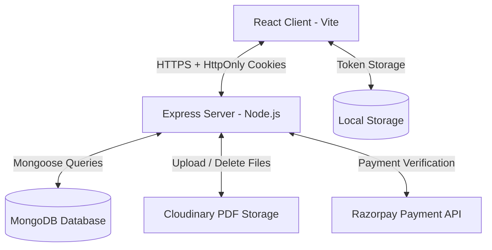

# 📚 StudyTogether

> **A Gamified Academic Resource Platform Built with the MERN Stack**

[](https://mongodb.com)
[](https://react.dev)
[](https://nodejs.org)
[](https://mongodb.com)
[](https://jwt.io)
[](https://opensource.org/licenses/ISC)

**StudyTogether** is a full-stack web application designed for **college students** to seamlessly upload, discover, and interact with peer-reviewed study materials. 

The platform incentivizes academic contribution through a custom **virtual economy**. Users earn "Study Coins" by uploading high-quality, admin-approved resources, which they can then spend to access other materials. Built on a robust **MERN (MongoDB, Express.js, React.js, Node.js)** architecture, it features secure JWT authentication, transactional database integrity, and an integrated **AI Study Copilot** utilizing Retrieval-Augmented Generation (RAG) for automated document analysis.

---

## 📋 Table of Contents

1. [Project Overview](#-project-overview)
2. [Key Features](#-key-features)
3. [Tech Stack](#-tech-stack)
4. [System Architecture Overview](#-system-architecture-overview)
5. [Folder Structure](#-folder-structure)
6. [Installation Guide](#-installation-guide)
7. [Environment Variables](#-environment-variables)
8. [Running the Project](#-running-the-project)
9. [Build & Production Commands](#-build--production-commands)
10. [User Roles & Permissions](#-user-roles--permissions)
11. [Major Workflows](#-major-workflows)
12. [Database Models Overview](#-database-models-overview)
13. [API Overview](#-api-overview)
14. [Security Features](#-security-features)
15. [Performance Optimizations](#-performance-optimizations)
16. [Screenshots](#-screenshots)
17. [Future Enhancements](#-future-enhancements)
18. [Contributing Guide](#-contributing-guide)
19. [License](#-license)
20. [Author](#-author)

---

## 🔍 Project Overview
StudyTogether incentivizes academic resource sharing. Students who upload high-quality study papers are rewarded with platform "Study Coins" once their uploads are approved by administrators. These coins are then spent to preview and download other students' papers. The platform features dynamic badge progression, streaks tracking, and user rankings, turning peer-to-peer learning into an interactive, gamified community experience.

---

## ✨ Key Features

*   **Secure Authentication**: Fully aligned JWT lifecycle featuring short-lived Access Tokens (15 min) and Secure SameSite HttpOnly Cookie Refresh Tokens (7 days) with instant device revocation.
*   **Draft Paper Support**: Save, edit, replace PDFs, delete, and publish papers as drafts. Drafts do not consume uploader limit slots.
*   **Approval & Moderation**: Single and bulk moderation queues allowing admins to inspect submitted PDFs on Cloudinary, approve them with uploader coins rewards (+30 coins), or reject them with automatic Cloudinary storage unlinking.
*   **Gamified Coin Economy**: Atomic coin balance manipulation preventing double-spending, negative balances, and concurrency conflicts.
*   **Leaderboard & Streaks**: Dynamic calculation of user ranks (Beginner 🥉, Explorer 🥈, Scholar 📘, Expert 🏆, Legend 👑) based on coins and approved uploads. Tracks daily streaks automatically to award 3-day and 7-day streak badges.
*   **Public User Profiles**: Privacy-respecting contributor profiles displaying public badges, contributions metrics, and a monthly contribution activity chart.
*   **Community Engagement**: Star ratings (one vote per user), multi-user comment feeds, and personal study material bookmarks.
*   **Admin Dashboard & Moderation**: Interactive metrics detailing total users, admins, views, downloads, comments, and transaction-safe aggregate system coin analytics. Moderation queues allow inspecting submitted PDFs, approving with uploader rewards (+30 coins), or rejecting with storage cleanup.
*   **Account Status Management**: Administrators can disable or re-enable user and admin accounts with mandatory audit reasons. Disabling an account immediately revokes refresh tokens, blocks future logins, and denies real-time access on all protected API endpoints. Administrators cannot disable their own accounts.
*   **Manual Coin Grants & Resilient Ledger**: Administrators can grant custom coin amounts (up to 10,000 coins) with audit reasons and persistent idempotency keys. The grant engine leverages single-document atomicity on `User.appliedGrants`, sparse unique indexes, and a crash-recoverable state machine preventing double-crediting across concurrent requests or network retries.
*   **Razorpay Gateway Integration**: Cryptographically verified checkout webhooks to securely buy Study Coins packages.
*   **AI Study Copilot**: Fully-integrated RAG assistant featuring real PDF text extraction, OCR fallback for scanned papers, hybrid keyword (BM25) and semantic retrieval, secure prompt validation, conversation history pruner, and automated study notes, mcq quizzes, flashcards, and strategic study plans.

---

## 🛠 Tech Stack

### Frontend
*   **React 19**: Core framework.
*   **Vite**: Fast, module-based bundler.
*   **Tailwind CSS**: Utility-first layouts.
*   **React Router DOM v6**: Client-side routing.
*   **TanStack React Query**: Server state caching, background refetches, and infinite scroll pipelines.
*   **React Infinite Scroll Component**: Handles paginated items lists.
*   **Axios**: Custom instance configured with `withCredentials: true` and interceptors for silent token refreshes.

### Backend
*   **Node.js**: Event-driven server environment.
*   **Express.js v5**: Routing framework.
*   **MongoDB**: Document-oriented database.
*   **Mongoose**: Schemas and queries modeling.
*   **Multer / Cloudinary**: Multipart file uploads processing and secure cloud PDF storage.
*   **Ollama**: Local host LLM model runner (mistral/nomic-embed-text).
*   **pdf-parse / tesseract.js / pdf-img-convert**: High-performance extraction, scanned document OCR pipeline, and page-rendering helper.

---

## 🏗 System Architecture Overview



---

## 📂 Folder Structure

```bash
FINAL_YEAR/
├── client/                      # React Frontend
│   ├── src/
│   │   ├── api/                 # Axios instance and endpoints functions
│   │   ├── components/          # Reusable UI elements (Modal, Skeletons, Navbar)
│   │   ├── context/             # AuthContext (state persistence & logout revocation)
│   │   ├── hooks/               # Custom React hooks (useAuth)
│   │   ├── pages/               # Page components (Leaderboard, Profile, Wallet, etc.)
│   │   └── App.jsx              # Routing and route guard layouts
│
├── server/                      # Node.js/Express Backend
│   ├── config/                  # Cloudinary and MongoDB connections
│   ├── middleware/              # Auth limits, file upload filters, NoSQL injection parsers
│   ├── models/                  # Mongoose Schemas (User, Paper, Transaction, Activity)
│   ├── routes/                  # API router controllers (auth, user, admin, paper, coin)
│   ├── services/                # Rank, badge, activity logging workflows
│   ├── utils/                   # Coin balance managers
│   └── server.js                # Server entry-point
```

---

## ⚙️ Environment Variables

### Backend (`server/.env`)
Create a `.env` file in the `server` directory:
```env
PORT=5000
MONGODB_URI=mongodb+srv://<username>:<password>@cluster.mongodb.net/studytogether
JWT_SECRET=your_super_secret_jwt_access_key
JWT_REFRESH_SECRET=your_super_secret_jwt_refresh_key
CLIENT_URL=http://localhost:5173
CLOUD_NAME=your_cloudinary_cloud_name
API_KEY=your_cloudinary_api_key
API_SECRET=your_cloudinary_api_secret
RAZORPAY_KEY_ID=your_razorpay_key_id
RAZORPAY_KEY_SECRET=your_razorpay_key_secret
RAZORPAY_WEBHOOK_SECRET=your_razorpay_webhook_secret
NODE_ENV=development

# AI Copilot Configs (Local Ollama LLM Runner)
AI_PROVIDER=ollama
OLLAMA_URL=http://localhost:11434
EMBEDDING_MODEL=nomic-embed-text
LLM_PROVIDER=ollama

# RAG Chunking Parameters
PDF_CHUNK_SIZE_WORDS=120
PDF_CHUNK_OVERLAP_WORDS=20

# Hybrid Retrieval Score Weights
SEMANTIC_WEIGHT=0.6
BM25_WEIGHT=0.4

# Session Memory Guard Limits
MAX_SESSION_MESSAGES=50
SESSION_TTL_SECONDS=2592000
```

### Frontend (`client/.env`)
Create a `.env` file in the `client` directory:
```env
VITE_API_URL=http://localhost:5000/api/v1
```

---

## 🚀 Installation Guide

### Prerequisites
*   Node.js installed (v18+ recommended)
*   MongoDB Instance (Local or MongoDB Atlas)
*   Cloudinary Account

### 1. Clone the Project
```bash
git clone https://github.com/SwarnenduMani22/FINAL_YEAR.git
cd FINAL_YEAR
```

### 2. Configure Backend
```bash
cd server
npm install
# Add your environment variables to .env
npm run dev
```

### 3. Configure Frontend
```bash
cd ../client
npm install
# Add your environment variables to .env
npm run dev
```

---

## 💻 Running the Project

*   **Backend Server**: Starts on `http://localhost:5000` (API endpoint root is `/api/v1`).
*   **Frontend Client**: Starts on `http://localhost:5173`.

---

## 📦 Build & Production Commands

### Backend Production Build
Deploy Node.js files directly. Run:
```bash
cd server
npm start
```

### Frontend Static Build
Generate optimized production static files:
```bash
cd client
npm run build
```
Vite compiles assets into `client/dist/` for static hosting (Vercel, Netlify, etc.).

---

## 👥 User Roles & Permissions

| Feature | Standard User | Platform Administrator |
| :--- | :---: | :---: |
| Browse & Search Papers | ✅ | ✅ |
| Preview & Download Papers | ✅ (Requires Coins) | ✅ (Free) |
| Save & Edit Draft Papers | ✅ (No Coin Cost) | ✅ |
| Submit Papers for Review | ✅ (Max 2 Pending) | ✅ (Instantly Approved) |
| Comment & Rate | ✅ | ❌ (View Only) |
| Manage Profile & Bookmarks | ✅ | ✅ |
| Process Refunds & Adjust Roles | ❌ | ✅ |
| Access Moderation Queues | ❌ | ✅ |
| View System Coin Analytics | ❌ | ✅ |

---

## 🔄 Major Workflows

### 1. Authentication & Token Refresh Flow
*   `/login` issues a short-lived JSON-access token and attaches a secure HttpOnly SameSite `refreshToken` cookie.
*   Client Axios interceptor catches expired tokens (401 response status) and calls `/refresh`.
*   If valid, `/refresh` returns a new access token. If revoked or expired, local storage is cleared and user is redirected to `/login`.

### 2. Paper Upload, Moderation & Coin Rewards
*   Users upload files (filtered: PDF only, max 5MB). Selecting "Save Draft" creates the paper with status `draft`.
*   Clicking "Publish" transitions the draft to `pending`, sending it to the Admin moderation queue.
*   Admins approve papers. Approved status increments uploader coins by `+30`, records uploader ranking metrics, and logs the action to the activity feed.

### 3. Coin Spending & Access Entitlements
*   Standard users pay 10 coins to unlock a paper preview (stored in `previewedPapers`) or 40 coins for a full download (`downloadedPapers`). Previewing first discounts the download cost to 30 coins.
*   The system uses atomic Mongoose updates (`coins: { $gte: cost }` and `$inc: -cost`) to prevent negative balances and concurrent overspending.

---

## 🗄 Database Models Overview

### 1. `User` Schema
```javascript
{
  name: { type: String, required: true },
  email: { type: String, required: true, unique: true },
  password: { type: String, select: false },
  role: { type: String, enum: ["user", "admin"], default: "user" },
  isActive: { type: Boolean, default: true },
  status: { type: String, enum: ["active", "disabled"], default: "active" },
  disabledReason: { type: String, default: null },
  disabledAt: { type: Date, default: null },
  disabledBy: { type: ObjectId, ref: "User", default: null },
  coins: { type: Number, default: 50, min: 0 },
  badges: { type: [String], default: [] },
  rank: { type: String, default: "Beginner" },
  totalUploads: { type: Number, default: 0 },
  approvedUploads: { type: Number, default: 0 },
  lastActiveDate: { type: String, default: "" },
  dailyStreak: { type: Number, default: 0 },
  bookmarks: [{ type: ObjectId, ref: "Paper" }],
  previewedPapers: [{ type: ObjectId, ref: "Paper" }],
  downloadedPapers: [{ type: ObjectId, ref: "Paper" }],
  statusHistory: [{ status: String, reason: String, changedBy: ObjectId, changedAt: Date }],
  appliedGrants: [{ idempotencyKey: String, amount: Number, appliedAt: Date }]
}
```

### 2. `Paper` Schema
```javascript
{
  title: { type: String, required: true },
  subject: { type: String, required: true },
  semester: { type: Number, required: true, min: 1, max: 8 },
  pdfLink: { type: String, required: true },
  uploadedBy: { type: ObjectId, ref: "User", required: true },
  status: { type: String, enum: ["draft", "pending", "approved"], default: "pending" },
  views: { type: Number, default: 0 },
  downloads: { type: Number, default: 0 },
  ratings: [{ user: { type: ObjectId, ref: "User" }, value: { type: Number, min: 1, max: 5 } }],
  comments: [{ user: { type: ObjectId, ref: "User" }, text: String, createdAt: Date }]
}
```

### 3. `Transaction` Schema
```javascript
{
  user: { type: ObjectId, ref: "User", required: true },
  amount: { type: Number, required: true },
  type: { type: String, enum: ["earned", "spent", "purchased", "refund", "bonus", "grant"], required: true },
  reason: { type: String, required: true },
  idempotencyKey: { type: String, sparse: true, unique: true },
  balanceApplied: { type: Boolean, default: false },
  status: { type: String, enum: ["pending", "completed", "failed"], default: "completed" },
  metadata: { type: Schema.Types.Mixed, default: {} }
}
```

### 4. `Activity` Schema
```javascript
{
  user: { type: ObjectId, ref: "User", required: true },
  actionType: { type: String, enum: ["upload", "badge_earned", "rank_up", "reject", "bonus"], required: true },
  details: { type: String, required: true }
}
```

---

## 📡 API Overview

### Authentication Router (`/api/v1/auth`)
*   `POST /register` — User signup.
*   `POST /login` — User signin (attaches HttpOnly cookie).
*   `POST /refresh` — Token refresh (reads HttpOnly cookie).
*   `POST /logout` — Token revocation (clears cookie).

### Papers Router (`/api/v1/papers`)
*   `GET /` — Paginated full-text search list (approved papers only).
*   `POST /upload` — Upload paper (accepts pdf file, checks limits).
*   `GET /:id` — Detailed paper metadata (populated uploader name).
*   `PUT /:id` — Update paper details, replace PDF file, or publish draft.
*   `DELETE /:id` — Authorized owner or admin delete paper (cascades).
*   `GET /:id/related` — Get related papers based on semester/subject.
*   `POST /:id/rate` — Rating submission.
*   `POST /:id/comment` — Comment addition.
*   `DELETE /:paperId/comment/:commentId` — Comment deletion.
*   `POST /:id/view` — Preview paper (coin deduction).
*   `POST /:id/download` — Download paper (coin deduction).

### User Router (`/api/v1/users`)
*   `GET /profile` — Retrieve personal session info & bookmarks.
*   `GET /my-papers` — List user's uploads (including drafts).
*   `GET /stats` — User metrics.
*   `GET /coin-overview` — Paginated, filtered coin transactions.
*   `GET /leaderboard` — Ranking dashboard.
*   `GET /activity` — Community activities feed.
*   `GET /public/:id` — Public contributor profile.
*   `GET /public/:id/stats` — Monthly contribution analytics.
*   `POST /bookmark/:id` — Toggle bookmark.

### Admin Router (`/api/v1/admin`)
*   `GET /stats` — Overall system & activity analytics.
*   `GET /users` — Paginated admin search for users.
*   `PUT /users/:id/status` — Disable or re-enable user/admin accounts with mandatory audit reasons.
*   `POST /users/:id/grant-coins` — Manual coin grants with audit reason and idempotent retry safety.
*   `DELETE /users/:id` — Delete user account (prevents self/last-admin deletions).
*   `PUT /users/:id/role` — Modify user role.
*   `POST /users/:id/refund` — Issue coin refund and log transaction.
*   `GET /coin-analytics` — System-wide coin metrics.

### AI Copilot Router (`/api/v1/ai`)
*   `GET /status` — AI system readiness, model information, chunk counts, and Ollama health check status.
*   `POST /chat` — Send query to the AI Copilot.
*   `POST /chat/stream` — Stream query response via SSE (Server-Sent Events) tokens.
*   `GET /history` — Get list of chat sessions for current user.
*   `GET /conversations/:id` — Retrieve full conversation messages and citations.
*   `DELETE /conversations` — Clear all conversation history.
*   `POST /study-notes` — Generate structured markdown study notes from paper.
*   `POST /quiz` — Generate practice MCQ quizzes (with options, answers, explanations).
*   `POST /flashcards` — Generate study flashcards (Question/Front and Answer/Back).
*   `POST /exam-plan` — Generate personalized strategic study plan.
*   `POST /reindex` — Admin trigger vector index rebuild.

---

## 🔒 Security Features

1.  **HttpOnly Cookies**: Prevents XSS attacks by isolating token refresh tokens from JavaScript access.
2.  **NoSQL Injection Prevention**: Sanitizes request payloads (`express-mongo-sanitize`) to neutralize operator syntax before hitting queries.
3.  **Strict Rate Limiting**: Global request limiting (`100/15min`), login protection (`10/15min`), and endpoint throttle protection (`5/min`) on payments and uploads.
4.  **Security Headers**: Helmet integration to set XSS, frame-blocking, and CSP protections.
5.  **CORS Isolation**: Specific origin matching and cookie sharing permissions configuration.
6.  **Role Verification**: Layered middlewares (`verifyToken` + `verifyAdmin`) securing backend access.

---

## ⚡ Performance Optimizations

1.  **Full-Text Search Indexing**: MongoDB native text indices on `title` and `subject` for immediate search completions.
2.  **Compound Database Indexing**:
    *   `{ coins: -1, approvedUploads: -1, totalUploads: -1 }` — Optimizes leaderboard aggregates.
    *   `{ subject: 1, semester: 1 }` — Speeds up search query filtration.
    *   `{ status: 1, isActive: 1 }` — Filters approved papers rapidly.
3.  **Aggregation Pipelines**: In-DB count summations and statistics processing.
4.  **Parallel Query Processing**: Parallel asynchronous calls (`Promise.all`) in admin controllers to reduce response latency.
5.  **Reactivity & Caching**: TanStack React Query caching to store fetch states locally and reduce backend API loads.

---

## 🖼 Screenshots
*(Visual mockup representations)*

```
+--------------------------------------------------------------+
|                         STUDYTOGETHER                        |
+--------------------------------------------------------------+
| [Browse Papers] [Upload Paper] [Leaderboard] [Wallet] (Profile)|
|                                                              |
| Welcome, Swarnendu 👋                                        |
|                                                              |
|   +-------------------+  +-------------------+  +----------+ |
|   | Approved Uploads  |  | Pending Uploads   |  | Coins    | |
|   |       12          |  |        1          |  |  280 🪙  | |
|   +-------------------+  +-------------------+  +----------+ |
|                                                              |
|   Study rank: Expert 🏆                                      |
+--------------------------------------------------------------+
```

---

## 🎯 Future Enhancements

*   **Notifications System**: Real-time push updates when a paper comment or rating is added.
*   **AI Recommendations**: Personalized matching algorithms suggestions on the dashboard.
*   **Automatic Grading**: Machine learning indexing to auto-check PDF content categories before moderation review.

---

## 🤝 Contributing Guide

1.  Fork the repository.
2.  Create your feature branch (`git checkout -b feature/NewFeature`).
3.  Commit your changes (`git commit -m "Add NewFeature"`).
4.  Push to the branch (`git push origin feature/NewFeature`).
5.  Open a Pull Request.

---

## 📄 License
Distributed under the ISC License. See `LICENSE` for more information.

---

## 👨‍💻 Author

*   **Swarnendu Mani**
    *   GitHub: [@SwarnenduMani22](https://github.com/SwarnenduMani22)
    *   Project: Final Year Project Submission
